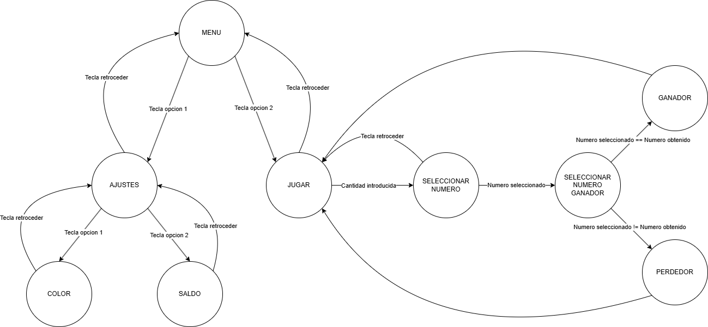

# Prácticas - Sistemas Empotrados (`Practicas_SE`)

Repositorio con las prácticas y el proyecto final desarrollados para la asignatura de **Sistemas Empotrados**, utilizando el entorno de desarrollo de Xilinx/AMD (**Vivado** para diseño hardware/FPGA y **Vitis** para programación embebida en C).

---

## 📋 Contenido del Repositorio

El proyecto está organizado en las siguientes carpetas y archivos principales:

| Directorio / Archivo | Descripción |
| :--- | :--- |
| **`Practica1/`** | Introducción al flujo de diseño hardware/software en Vivado y Vitis (GPIO, LEDs, switches). |
| **`Practica2/`** | Uso de temporizadores, interrupciones y UART. |
| **`Practica3/`** | Diseño de periféricos personalizados IP Core / AXI. |
| **`Practica4/`** | Control de periféricos externos, displays, teclados matriciales y PWM. |
| **`Practica5/`** | Comunicación serie SPI/I2C e integración de sensores. |
| **`ProyectoFinal/`** | **Proyecto Final: Ruleta Electrónica**. Implementación completa del sistema empotrado y su lógica de control. |
| **`TESTS/`** | Bancos de pruebas (*testbenches*) y scripts de verificación de los módulos desarrollados. |
| **`Puertos.xlsx`** | Documentación y mapeo de pines/puertos utilizados en la placa FPGA. |

---

## 🎰 Proyecto Final: Máquina de Estados

El proyecto final consiste en el desarrollo de un sistema de ruleta implementado sobre FPGA/MicroBlaze. El comportamiento y las transiciones del sistema siguen el siguiente diagrama de estados:



---

## 🛠️ Herramientas y Requisitos

* **Hardware:** Placa de desarrollo FPGA (Digilent Basys 3).
* **Diseño Hardware:** Xilinx Vivado Design Suite.
* **Desarrollo Software:** Xilinx Vitis Unified Software Platform.
* **Lenguajes:** VHDL / Verilog (Hardware) y C (Software embebido).

---

## 🚀 Cómo ejecutar los proyectos

1. **Clonar el repositorio:**
   ```bash
   git clone [https://github.com/oscarFPG/Practicas_SE.git](https://github.com/oscarFPG/Practicas_SE.git)
